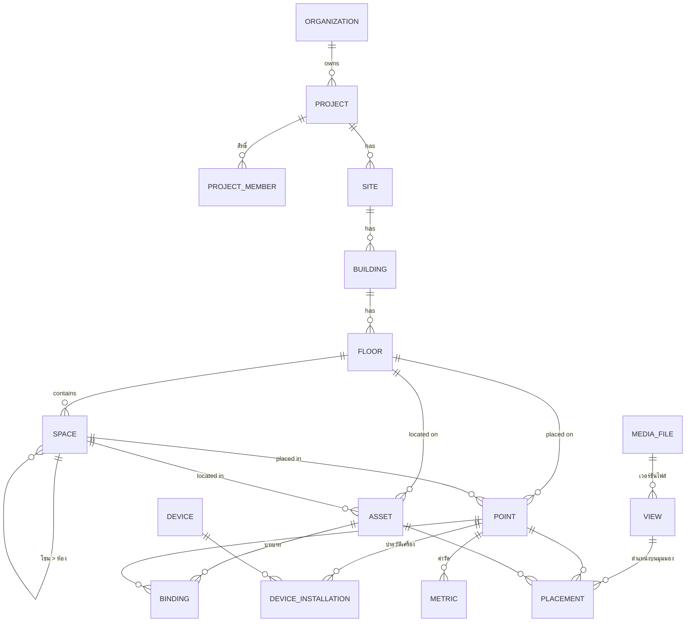
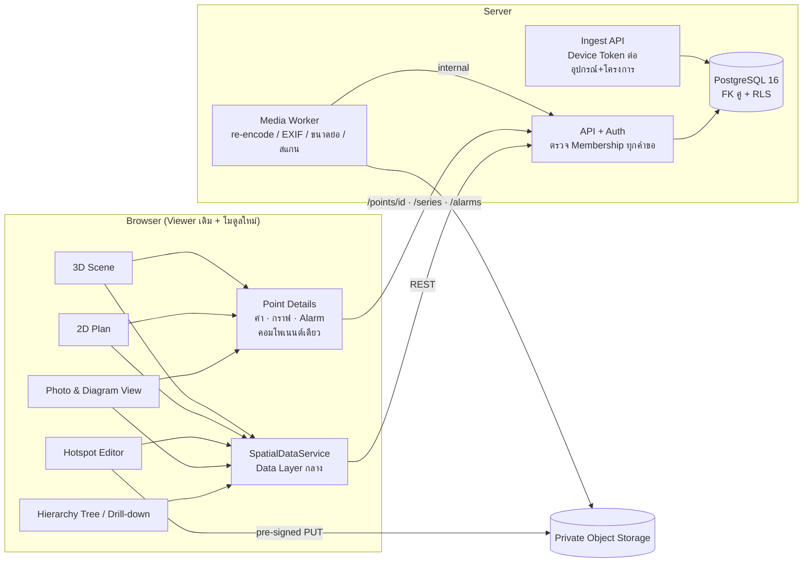

# Floor Plan Platform v2 — Project Hierarchy + Photo & Diagram View (ร่างออกแบบเพื่ออนุมัติ)

> สาขา `feature/platform-hierarchy-photo-design` (แยกจาก `feature/data-layer` `270f050`) · **เอกสารออกแบบเท่านั้น ยังไม่เขียนระบบจริง**
> Pilot Project = Fortune (FRT) · Demo `cloudflare-preview` `4ab02db` Freeze ไม่แตะ · ไม่ Merge `main` · ไม่แตะ `gh-pages`
> ต่อยอดจาก `design/floor-plan-platform` (ARCHITECTURE/MIGRATION/RELEASE-CHECKLIST — อ่านอย่างเดียว ไม่แก้สาขานั้น) และ Data Layer (`docs/data-layer/DATA-LAYER-PLAN.md` rev3)

| ไฟล์ | เนื้อหา |
|---|---|
| `README.md` | เอกสารนี้: Architecture, ลำดับโมดูล 1–5, เกณฑ์ผ่าน, ประเด็นที่ต้องตัดสิน |
| `db/hierarchy_photo.sql` | Database Schema (PostgreSQL 16) + Row-Level Security + trigger |
| `db/test_hierarchy_photo.sql` | ทดสอบ schema บน PostgreSQL 16 จริง — **ผ่าน 17/17** (แยกโครงการ, IDOR, Hotspot, เปลี่ยนรูป, AI อนุมัติไม่ได้ ฯลฯ) |
| `api/hierarchy-photo.openapi.yaml` | API Contract (OpenAPI 3.1) — ผ่าน `openapi-spec-validator` (16 path, 16 schema) |
| `wireframes/wireframes.html` + `w1–w6.png` | Wireframe Desktop/มือถือ (ภาพร่างโครง ไม่ใช่ดีไซน์สุดท้าย) |

---

## 1. เป้าหมายและเกณฑ์รับมอบ

1. ลำดับชั้นเดียวของทุกโครงการ: **องค์กร → โครงการ → ไซต์ → อาคาร → ชั้น → ห้อง/พื้นที่ → Asset → Sensor → ค่าวัด**
2. ดูข้อมูลบน **รูปจริง/แผนภาพ** ได้ (รูปห้อง รูปเครื่องจักร แผนภาพระบบ) ด้วย Hotspot ที่แสดงค่า/สถานะสด
3. **จุดเดียวกัน = Stable ID เดียวกัน**: เปิดจาก Photo, 2D หรือ 3D แล้วได้ ข้อมูล กราฟ และ Alarm ชุดเดียวกัน (ทดสอบรับมอบ W5)
4. Fortune เป็นโครงการแรกบนโครงสร้างนี้ โดย **ภาพ สี ตำแหน่ง หมุด ถัง ปั๊ม ลิฟต์ ห้อง และ Flow เดิมไม่เปลี่ยน**
5. แยกโครงการระดับฐานข้อมูล (ไม่ใช่แค่ซ่อนเมนู) — ตามข้อกำหนดเดิม: Backend ตรวจ Project Membership ทุกคำขอ ไม่เชื่อ `projectId` จาก Frontend

## 2. ลำดับชั้นข้อมูล (Project Hierarchy)

| ระดับ | ความหมาย | Fortune (Pilot) |
|---|---|---|
| Organization | เจ้าของข้อมูล/สัญญา · มี `namespace_id` สำหรับ UUID v5 ของข้อมูลเดิม | Fortune Demo Organization (UUID เดิมจาก Data Layer) |
| Project | หน่วยสิทธิ์ผู้ใช้ · ค่าตั้งต้น (เช่นสถานะเริ่มต้นของจุดใหม่) | FRT · `defaultPointInstallStatus = installed` |
| Site | ที่ตั้งทางกายภาพ (โครงการหนึ่งมีหลายไซต์ได้) | ฟอร์จูนทาวน์ |
| Building | ระบบพิกัดอาคาร (Building CRS) | FORTUNE-TOWN (โพเดียม + ทาวเวอร์) |
| Floor | ลำดับ ระดับความสูง FloorFrame (affine) มุมมองผัง/โมเดลปัจจุบัน | G, 1–5, 11–32 |
| Space | โซน/ห้อง/ร้าน ซ้อนกันได้ · รูปทรงบนผัง | `G-SVC`, `3-MALL` + ห้องจาก `rooms-*.json` |
| Asset | อุปกรณ์/เครื่องจักร (ชนิดจาก Asset Catalog) | ปั๊ม, บ่อ, ถัง, AHU (`FRT-DEMO-*`) |
| **Sensor** | **= Point (จุดตรวจวัด) + Device (เครื่องจริงที่ติดอยู่)** | WL-001 + เครื่อง GW-02 |
| Metric (ค่าวัด) | ช่องข้อมูลของจุด (หน่วย ช่วง เกจ) | level, temp, rh, run, current |

**ทำไมแยก Point กับ Device** — Point คือ "ตำแหน่งที่วัด" ที่คนเห็นและมีประวัติ (UUID ถาวร) ส่วน Device คือฮาร์ดแวร์ที่เปลี่ยนได้ เปลี่ยนเครื่อง = ปิดประวัติการติดตั้งเดิม เปิดแถวใหม่ — กราฟและ Alarm ยังต่อเนื่องที่จุดเดิม (ทดสอบข้อ 10) · ข้อมูลเข้าจับคู่ด้วย `(projectId, device.source_key, metric.source_key)` แล้วตรวจกติกา Lifecycle เดียวเหมือน Data Layer ปัจจุบัน

## 3. Photo & Diagram View

| เรื่อง | การออกแบบ |
|---|---|
| มุมมอง (View) | `plan` (ผังชั้น), `model` (3D), `photo` (รูปห้อง/เครื่องจักร), `diagram` (แผนภาพระบบ เช่น one-line, P&ID) · แต่ละ View ผูกกับชั้น/ห้อง/Asset และไฟล์ 1 เวอร์ชัน |
| Hotspot | = **Placement** ของ Point/Asset/Space บน View: หมุด / กรอบ / หลายเหลี่ยม ในพิกัด u,v (0–1) ของภาพ → ไม่ขึ้นกับความละเอียดหรือการย่อรูป · 3D ใช้ x,y,z ใน Building CRS |
| ค่าที่แสดง | ค่า/สถานะ/ชื่อ/ไอคอน · สี เส้นประ (ยังไม่ติดตั้ง) และ “!” (ต้องตรวจตำแหน่ง) **ใช้กติกาเดียวกับหมุด 2D/3D** (`telemetryDecision` + `pointStatus`) |
| แตะ Hotspot | เปิด **แผงรายละเอียดตัวเดียวกับ 2D/3D** (ค่า กราฟ แจ้งเตือน) + ปุ่ม “ดูจุดนี้ในมุมมองอื่น” จาก `/appearances` |
| เปลี่ยนรูป | อัปโหลดรูปใหม่ = ไฟล์ใหม่ (SHA-256 ใหม่) · Hotspot ไม่ถูกลบ → `needs_remapping (image-changed)` แสดงที่ตำแหน่งเดิม · หน้าตรวจแบบรูปเดิม/รูปใหม่ข้างกัน แล้ว “ยืนยัน” หรือ “ย้าย” (W4) |
| อนุมัติ | View แบบ draft → review_required → approved → published · อนุมัติ/เผยแพร่ได้เฉพาะคน (AI/บัญชีบริการถูก DB ปฏิเสธ — ทดสอบข้อ 8) |
| ความเป็นส่วนตัว | รูปอาจมีคน/ข้อมูลหน้างาน: bucket แบบ private เท่านั้น (ไม่ใช่ CDN สาธารณะเหมือนผัง), signed URL อายุสั้น, worker **เข้ารหัสใหม่และตัด EXIF/GPS** ก่อนใช้, แนวทางถ่ายรูป (ไม่ถ่ายหน้าคน/เอกสาร), ลบได้ตามคำขอ (เก็บ audit) |
| ความปลอดภัยไฟล์ | pre-signed PUT ≤ 10 นาที, ตรวจ SHA-256 + magic bytes + ขนาดภาพ (≤ 50 MB, ≤ 12,000 px ต่อด้าน), สแกนไวรัส, เข้ารหัสภาพใหม่ (ตัด polyglot/สคริปต์ฝัง), ไม่ยอมรับ SVG ที่ผู้ใช้อัปโหลด (กัน XSS) |
| ประสิทธิภาพ | ขนาดย่อ 480 / 1600 / 4096 px (WebP) · โหลดตามขนาดจอ · Hotspot วาดเป็น SVG ชั้นบนรูป ≤ 300 ต่อรูป · ค่าสดใช้ข้อมูลชุดเดียวกับ 2D/3D (ไม่ดึงแยกต่อ Hotspot) · ไม่ใช้ WebGL ในหน้ารูป → เครื่องสเปกต่ำใช้ได้ |
| มือถือ | ถ่างนิ้วซูม/ลาก · แตะ Hotspot เปิด Bottom Sheet · ปุ่ม ≥ 44 px · สลับ 2D/3D/รูป ด้วยแท็บเดียว (W3) |

## 4. Architecture

- **Frontend**: เว็บเดิมตัวเดียว · โมดูลใหม่อ่านจาก `SpatialDataService` (ต่อยอด Data Layer ที่ผ่าน Regression แล้ว) — ไม่มีชื่อ/ตำแหน่ง/ไฟล์ของโครงการฝังในโค้ด
- **Backend**: ตามที่ออกแบบใน `design/floor-plan-platform` (Node + PostgreSQL + R2) โดยเปลี่ยนเป็น UUID + องค์กร + FK คู่ + RLS ตามไฟล์ schema ใหม่นี้
- **Project Isolation 3 ชั้น**: (1) API หา membership จาก session ไม่ใช่จาก body/path · (2) RLS ใน DB บังคับทุก query (ทดสอบ: ไม่มี session = ไม่เห็นอะไร, เดา UUID ข้ามโครงการไม่ได้) · (3) FK แบบคู่ `(project_id, id)` ทำให้ความสัมพันธ์ข้ามโครงการเป็นไปไม่ได้แม้โค้ดผิด · ตอบ 404 เหมือนกันทั้ง "ไม่มี" และ "ไม่มีสิทธิ์" (กันการเดา)
- **Device Token**: เก็บเฉพาะ hash · ผูกอุปกรณ์ + โครงการ · หมุนได้ · Service Key อยู่ฝั่ง Server เท่านั้น

## 5. Fortune เป็น Pilot — การย้ายโดยไม่เปลี่ยนภาพ

1. ใช้ UUID v5 เดิมของ Data Layer (namespace องค์กร + Project UUID + ชนิด + รหัสเดิม) → UUID ของ Point/Asset/Floor ใน DB ตรงกับที่ Preview ใช้อยู่ทุกตัว
2. Space: จาก `building.areas` (โซน) + `rooms-*.json` (ห้องจากโมเดล) เป็นลูกของโซน
3. View ผัง/โมเดล: จากไฟล์ใน `public/plans`, `public/models` + SHA-256 จาก asset manifest (มีอยู่แล้ว) · placement ของหมุดเดิม = `plan` u,v เดิม (ทดสอบ ≤ 1e-12 กับสูตรเดิม)
4. รูปห้อง/เครื่องจักร: ยังไม่มีรูปจริงของ Fortune → Pilot ใช้รูปที่ทีมถ่ายเพิ่ม (ห้องปั๊ม ชั้น G, ห้อง AHU ชั้น 11) — **รอผู้ใช้จัดหารูป**
5. เกณฑ์: ภาพ/พิกัด Fortune ก่อน–หลังเท่าเดิม (เครื่องมือเทียบฉากที่ใช้ในรอบ Data Layer), e2e ทั้ง 6 ชุด + Playground ผ่าน

## 6. ลำดับโมดูลที่เสนอ

| ลำดับ | โมดูล | ทำอะไร | ต้องมีก่อน | Checkpoint ย่อย (แต่ละข้อมี Preview แยก) |
|---|---|---|---|---|
| 0 | ปิดงาน Data Layer | เปลี่ยน ID ภายในเป็น UUID + ใช้ฐาน `@v6` (Commit 3 มีฟังก์ชันแล้ว) + บันทึก Audit ถาวร + วัด FPS GPU จริงตามเกณฑ์ 5.1 | อนุมัติ (กระทบประวัติข้อมูลในเครื่อง) | 0a UUID ภายใน · 0b ย้ายฐาน + ย้อนกลับ · 0c Performance |
| 1 | **Project Hierarchy** | ต้นไม้/เจาะทีละระดับ, Space จากโซน+ห้อง, Device + ประวัติการติดตั้ง, สรุปสถานะต่อโหนด (W1, W6) | 0 | 1a โมเดลข้อมูลในเบราว์เซอร์ + Unit · 1b หน้า Hierarchy (Fortune อ่านอย่างเดียว) · 1c Device/ติดตั้ง |
| 2 | **Photo & Diagram View** | อัปโหลดรูป (ในเบราว์เซอร์ก่อน ยังไม่มี Backend), Hotspot, ค่าสดบนรูป, แก้ไข/ตรวจตำแหน่งหลังเปลี่ยนรูป (W2–W4) | 1 | 2a แสดงรูป + Hotspot อ่านอย่างเดียว · 2b Editor · 2c เปลี่ยนรูป → Needs Remapping |
| 3 | **Stable ID ข้ามมุมมอง** | `/appearances`, ปุ่ม “ดูในมุมมองอื่น”, ทดสอบรับมอบ W5 อัตโนมัติ (ค่า/กราฟ/Alarm เท่ากันทุกมุมมอง) | 1, 2 | 3a appearances · 3b e2e ข้ามมุมมอง |
| 4 | Sensor Placement & Installation Planning | Asset Catalog, ลากวาง, Coverage (รัศมีครอบคลุม), Approval (เสนอ → อนุมัติ → ติดตั้ง → ส่งมอบ), BOM, PDF | 1–3 | 4a Catalog · 4b ลากวาง + Coverage · 4c Approval · 4d BOM/PDF |
| 5 | Backend/API, Authentication, Role, Project Isolation | ใช้ schema/API ชุดนี้จริง, OIDC, RLS, Device Token, Audit, ทดสอบ IDOR/BOLA อัตโนมัติ, ย้ายข้อมูลจากเบราว์เซอร์ขึ้น Server | ออกแบบพร้อมแล้ว (ไฟล์นี้) | 5a Auth + Membership · 5b API อ่าน · 5c API เขียน + Audit · 5d Ingest + Device Token · 5e Security test |

หมายเหตุลำดับ: โมดูล 1–3 ทำในเบราว์เซอร์ก่อนได้ (เหมือน Data Layer) เพื่อให้ทดลองบน Preview เร็ว แต่ **ข้อมูลรูปจริงของลูกค้าไม่ควรใช้งานจริงก่อนโมดูล 5** (ไม่มีการยืนยันตัวตน/แยกโครงการฝั่ง Server) — Preview ของโมดูล 2 ใช้รูปตัวอย่าง/รูปที่อนุญาตเท่านั้น

## 7. เกณฑ์ผ่านทุก Checkpoint (ก่อนส่ง Preview และก่อนพิจารณารวม)

| หมวด | เกณฑ์ |
|---|---|
| Unit | ผ่านทั้งหมด + ทดสอบใหม่ของโมดูล |
| Regression | e2e ทั้ง 6 ชุด + Data Layer Playground ด้วยสคริปต์ฉบับเดียวกัน รันสลับกับ build ฐาน · ไม่มี FAIL ที่ไม่ได้จัดประเภท |
| ภาพ Fortune | โครงสร้างฉาก/ผัง 2D/ถัง/ปั๊ม/หมุดเท่าเดิม (ต่างเฉพาะสิ่งที่เคลื่อนตามเวลา) |
| Security | ทดสอบ schema (RLS/FK คู่/IDOR) ผ่านทุกข้อ · ไม่มีความลับใน Frontend/Git/Build · อัปโหลด: ชนิด/ขนาด/EXIF/SVG |
| Performance | GPU จริง (Intel Iris Xe) ตามเกณฑ์ 5.1: FPS ลดไม่เกิน 5%, p95 frame time ไม่เพิ่มเกิน 10%, Draw Calls เท่าเดิม · หน้ารูป: แสดงผลครั้งแรก ≤ 2.5 วิ บนมือถือเครือข่ายปกติ |
| Memory | JS Heap ไม่เพิ่มต่อเนื่องหลังใช้ 10 นาที (สลับรูป/ชั้น/มุมมอง 50 รอบ) |
| Desktop / Mobile | 1440, 1280, 820, 390, 360 px · ไม่ล้นแนวนอน · ปุ่ม ≥ 44 px บนมือถือ · Console/Network Error = 0 |

## 8. ประเด็นที่ต้องตัดสิน (ขออนุมัติ)

1. ลำดับชั้นมี **Site** แยกจาก Project หรือไม่ (เสนอ: มี — โครงการเดียวหลายไซต์ได้)
2. นิยาม **Sensor = Point + Device** (จุดคงที่ เปลี่ยนเครื่องได้) แทนการให้ “Sensor” เป็นเครื่องเพียงอย่างเดียว
3. อนุมัติให้ทำ **โมดูล 0** (UUID ภายใน + ฐาน `@v6`) ก่อนโมดูล 1 หรือให้โมดูล 1–2 ใช้ทางแปลงที่ขอบไปก่อน
4. รูปของ Fortune สำหรับ Pilot: ห้องใดบ้าง ใครถ่าย และอนุญาตให้อยู่บน Preview หรือไม่
5. Backend: PostgreSQL ของตัวเอง หรือ Supabase (schema นี้ใช้ได้ทั้งสองแบบ) · ผู้ให้บริการ Login (Google Workspace องค์กร?)
6. บทบาท: owner / admin / editor / installer / approver / viewer — ใครอนุมัติ View และการติดตั้ง
